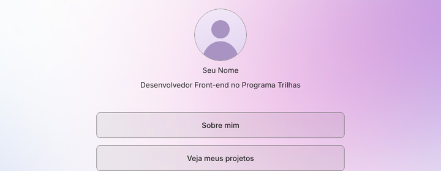

# Meu primeiro portfólio

Portfólio pessoal desenvolvido como primeiro desafio da trilha **Desenvolvimento Front-end** do **Programa Trilhas** (plataforma +Robotic).

A página apresenta meu perfil e reúne meus projetos e certificados, seguindo o design disponibilizado no Figma (*Portfolio / Front-end*).



## Páginas

| Página | Arquivo | Conteúdo |
| --- | --- | --- |
| Início | `index.html` | Foto, nome, descrição "Desenvolvedor Front-end no Programa Trilhas", botões **Sobre mim**, **Veja meus projetos** e **Acesse os meus certificados**, links para GitHub e LinkedIn |
| Sobre mim | `sobre.html` | Perfil no topo e, abaixo, um texto sobre minha trajetória, interesses e objetivos |
| Projetos | `projetos.html` | Perfil no topo e, abaixo, uma lista de cards com foto e botão para acessar cada projeto |
| Certificados | link externo | O botão abre uma pasta do Google Drive com meus certificados |

## Tecnologias

- **HTML5** semântico (`header`, `main`, `nav`, `section`, `footer`, listas para cards e redes sociais)
- **CSS3** com variáveis (`:root`), Flexbox e CSS Grid
- **Git e GitHub** para versionamento e publicação
- **Figma** como referência de layout
- Fonte **Inter** (Google Fonts), a mesma usada no design

## Fidelidade ao Figma

As medidas foram tiradas diretamente do arquivo do Figma (frames de 1440 × 1024):

- Coluna da página inicial com **588px**; botões de **540 × 56px**, espaçamento de **16px**, borda de 1px e cantos de **8px**
- Colunas das páginas Sobre mim e Projetos com **800px**
- Cards de projeto com **392 × 204px**, imagem de **360 × 140px**, padding de 16px e espaço de 16px entre os cards
- Texto em Inter 16px com altura de linha de 24px
- Conteúdo centralizado na tela e fundo em degradê rosa/lilás

## Responsividade e acessibilidade

- Layout adaptado para celular e tablet (os cards passam para uma coluna, os botões ocupam a largura da tela)
- Textos alternativos (`alt`) em todas as imagens e `aria-label` nos ícones de GitHub e LinkedIn
- Links externos abrem em nova aba com `rel="noopener noreferrer"`
- Estado de foco visível para quem navega pelo teclado
- Na página Sobre mim e na página Projetos, clicar na foto ou no nome volta para a página inicial

## Arquivos

```
meu-portfolio/
├── index.html            # Página inicial
├── sobre.html            # Página "Sobre mim"
├── projetos.html         # Página "Veja meus projetos"
├── style.css             # Todos os estilos
├── fundo.jpg             # Fundo em degradê
├── foto-perfil.png       # Minha foto
├── favicon.svg           # Ícone da aba do navegador
├── portfolio.png         # Imagem do card "Meu primeiro portfólio"
├── sistema-cadastro.png  # Imagem do card "Sistema de Cadastro"
└── em-breve.png          # Imagem dos cards dos próximos projetos
```

## Como abrir

Basta abrir o arquivo `index.html` no navegador. Também é possível ver a versão publicada pelo GitHub Pages.

## Próximos passos

Conforme eu avançar no Programa Trilhas, vou adicionar novos projetos na página **Projetos**.

---

Feito com ❤ por Thiago malta 
